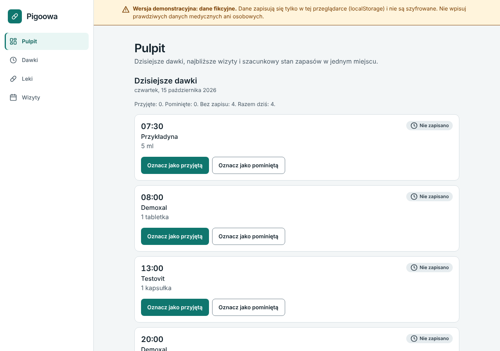
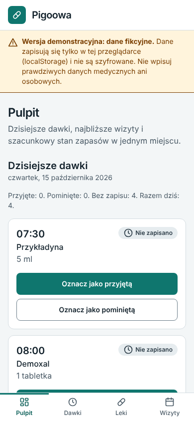
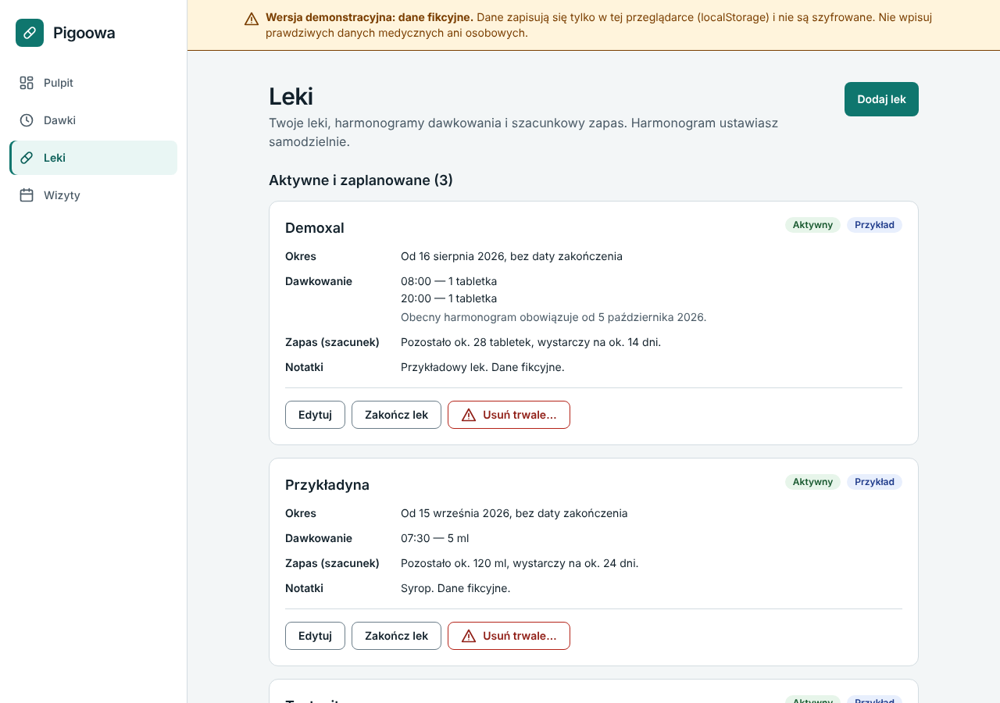
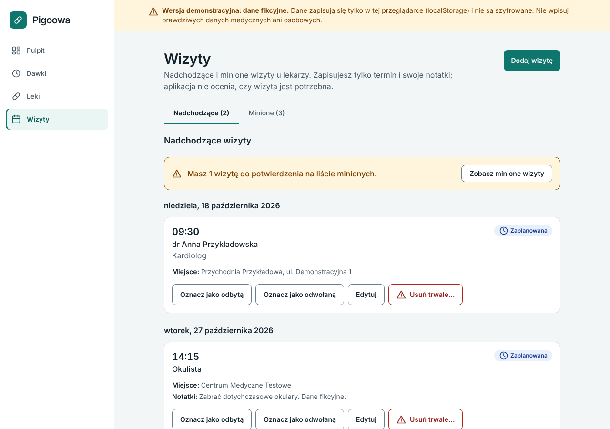

# Pigoowa

**Medication and doctor appointment tracker** — a web application for organising medications, dosage schedules, intake history and doctor appointments. The user interface is in Polish.

**Live demo: <https://pigoowa-medication-doctor-visit-tra.vercel.app/>**: fictional data only. Everything you enter is kept in your own browser (`localStorage`), unencrypted, so use invented data and never real medical or personal data. See [Deployment](#deployment).

> **Project status: Stage 9 of 12 is nearly complete: tests, accessibility fixes, the demo notice and the hosting configuration are done and the public demo is deployed (see [Deployment](#deployment)); a manual check of the live demo on a phone is still open, so the MVP is not yet declared complete. Stages 1–8: scaffold, domain logic, design foundation, data layer, medication management, daily doses and history, doctor appointments, dashboard.** The app is a responsive, accessible Polish-language shell (sidebar on desktop, bottom bar on phones). **Pulpit (Dashboard), Leki (Medications), Dawki (Doses) and Wizyty (Appointments) work**: you can add, edit, end and permanently delete medications, mark each day's doses as taken or skipped (and undo that), browse and filter the intake history, see an explained stock estimate, and keep a list of upcoming and past doctor appointments; data is kept in the browser's `localStorage` (fictional/demo data only, see the notice below). All four sections are real screens. Reminders and alarms do not exist (a future requirement, see [docs/ROADMAP.md](docs/ROADMAP.md)). Sections marked *(planned)* describe intended behaviour, not existing functionality. Progress is tracked in [docs/ROADMAP.md](docs/ROADMAP.md).

## Important notice

Pigoowa is an organisational tool. It does not give medical advice, does not recommend or change doses, and does not decide whether a medication should be taken. Schedules are configured by the user and are not verified by any healthcare professional. The demo uses fictional data only, and every page says so.

## Planned features (MVP)

- **Dashboard** – today's doses with taken/skipped actions, next appointments, stock summary.
- **Medications** – add/edit/delete, daily schedule with several times per day, optional stock with an explicitly documented estimate, intake history.
- **Doctor appointments** – add/edit/delete, upcoming and past lists grouped by date, completed/cancelled status.

Out of scope for the MVP: AI assistant, OCR, billing, caregiver sharing, calendar sync, push notifications, advanced analytics, interaction checking. See [docs/PROJECT_SPEC.md](docs/PROJECT_SPEC.md).

## Technology stack

Installed now (versions as resolved by `package-lock.json`):

| Purpose | Package | Version |
|---|---|---|
| UI | react, react-dom | 19.3.1 |
| Routing | react-router | 7.18.4 |
| Build/dev server | vite, @vitejs/plugin-react | 8.3.4, 6.1.2 |
| Language | typescript (strict) | 6.0.3 |
| Styling | tailwindcss, @tailwindcss/vite | 4.3.3 |
| Unit/component tests | vitest, jsdom, @testing-library/react, jest-dom, user-event | 5.0.5, 29.1.1, 16.3.3, 7.0.1, 14.6.8 |
| End-to-end tests | @playwright/test | 1.64.1 |
| Accessibility checks in the browser | @axe-core/playwright (dev dependency, MPL-2.0) | 4.14.0 |
| Forms and validation | react-hook-form, zod, @hookform/resolvers | 7.90.0, 4.6.7, 5.9.1 |
| Linting | eslint, typescript-eslint, react-hooks, jsx-a11y, react-refresh plugins | 9.39.5, 8.71.2, 7.1.1, 6.10.2, 0.5.7 |
| Formatting | prettier | 3.9.10 |

Planned for later stages: Supabase (stages 10–11), TanStack Query (stage 11). Hosting for the demo: Vercel (deployed, see [Deployment](#deployment)).

Notes on version choices: ESLint is on the 9.x line because `eslint-plugin-jsx-a11y` does not yet support ESLint 10; TypeScript is on 6.0.x because `typescript-eslint` supports `<6.1`; React Router is on 7.x (stable, Node >= 20) rather than 8.x (requires Node >= 22.22).

## Documentation

| Document | Contents |
|---|---|
| [docs/PROJECT_SPEC.md](docs/PROJECT_SPEC.md) | Requirements, business rules, decisions, architecture, risks, testing strategy |
| [docs/ROADMAP.md](docs/ROADMAP.md) | Development stages with completion criteria |
| [docs/DATABASE.md](docs/DATABASE.md) | Data model, constraints, Row Level Security, migration approach |

## Getting started

Prerequisite: Node.js >= 22.12 and npm.

```bash
npm install
npm run dev        # start the dev server at http://localhost:5173
```

No environment variables are needed yet.

### Scripts

| Script | What it does |
|---|---|
| `npm run dev` | Vite dev server with hot reload |
| `npm run build` | Type-check (`tsc -b`) and produce a production build in `dist/` |
| `npm run preview` | Serve the production build locally |
| `npm run typecheck` | TypeScript strict type check, no output |
| `npm run lint` | ESLint (type-aware rules, React hooks, accessibility) |
| `npm run format` / `format:check` | Prettier: rewrite / verify formatting of source files |
| `npm test` / `npm run test:watch` | Vitest unit and component tests (once / watch mode) |
| `npm run e2e` | Playwright end-to-end tests against the dev server (starts it itself) |
| `npm run e2e:preview` | Playwright checks of the **production build** served as a static site (builds first) |
| `npm run screenshots` | Regenerates `docs/screenshots` from the fictional demo data (not a test run) |

### Running end-to-end tests

Install the browser once with `npx playwright install chromium`. If you already have a Chromium binary, set `PLAYWRIGHT_CHROMIUM_EXECUTABLE_PATH` to its path instead.

The tests use a fixed clock (`2026-10-15T10:00:00Z`, time zone `Europe/Warsaw`) and fictional data, so they do not depend on the day they run. The suites are:

- `e2e/journey.spec.ts`: the main journey from an empty start (add a medication, record a dose, reload, add / edit / cancel / restore an appointment) and a keyboard-only journey.
- `e2e/accessibility.spec.ts`: axe-core scans (WCAG 2.0/2.1 A and AA plus best-practice rules) of every main screen and state at 390 px and 1280 px, and a check that touch targets are at least 44 px on phones. A self-check proves the scan reports injected problems, so "no violations" is not an empty result.
- the feature specs (`medications`, `doses`, `appointments`, `dashboard`, `layout`, `keyboard`, `dialog`, `data`, `smoke`): behaviour, validation, failed reads and writes, keyboard operation and layout.
- `e2e-preview/`: the production build only (see Deployment).

Automated checks do not replace a manual accessibility review with a screen reader; none was done with real assistive technology.

### Data layer and demo data

The data layer sits behind interfaces (`src/services/repositories.ts`) so that the screens never know where data lives. Today it is stored in the browser's `localStorage`; a Supabase implementation is planned for stage 11 and is **not** implemented.

> **Browser storage is not secure storage.** `localStorage` is plain text that any script on the page and anyone with access to the browser profile can read. It is used here only for fictional demo data and development. It is not a substitute for a secure production backend, and nothing in this repository claims the app is production-ready or compliant with privacy law. Do not enter real medical information.

| What | Where |
|---|---|
| Interfaces: medications, intake records, appointments | `src/services/repositories.ts` |
| Browser-storage implementation | `src/services/local/` |
| Fictional demo data (pure function) | `src/services/demo/demoData.ts` |
| Typed errors with Polish messages | `src/services/errors.ts` |
| Clock, id generator | `src/utils/clock.ts`, `src/utils/id.ts` |
| Services provider and hooks | `src/app/ServicesProvider.tsx`, `src/hooks/useServices.ts`, `src/hooks/useAsyncData.ts` |
| Data hooks | `useMedications`, `useMedication(id)`, `useDoseLogs`, `useAppointments` in `src/features/*/hooks/` |
| Write helpers | `useAsyncAction` (`src/hooks/`): one write at a time, unmount-safe, reports success/failure; `useDoseActions` and `applyDoseAction` (`src/features/doses/`): record, change and clear doses |

**Storage keys and format.** One key per kind of record, each holding `{ "version": 1, "items": [ ... ] }`:

- `pigoowa:v1:medications`, `pigoowa:v1:dose-logs`, `pigoowa:v1:appointments`
- `pigoowa:v1:backup`: the previous contents saved by a demo-data reset (one slot, only the latest)

Data with a different version is refused rather than guessed at. There are no migrations, because there is nothing to migrate yet.

**Errors and corrupt data.** Everything read from storage is validated field by field. Invalid JSON, wrong shapes, missing fields, duplicate ids and the like produce a `RepositoryError` (for example `data-corrupted`) and the operation stops: damaged data is never treated as an empty database and never overwritten. Unreachable storage and full storage are reported as `storage-unavailable` and `storage-full`. Error messages are in Polish and never contain stored values, and the code never logs to the console. Details and the complete list of error codes are in [docs/PROJECT_SPEC.md](docs/PROJECT_SPEC.md) §10.4.

**Demo data and reset.** The demo data is invented (names, doctors and places are fictional; ids start with `demo-`). Nothing loads or resets it automatically. To use it while developing:

```bash
npm run dev
# open http://localhost:5173/dev/data
# "Wczytaj dane demonstracyjne" fills EMPTY storage with demo data
# "Przywróć dane demonstracyjne…" replaces everything after a confirmation
```

A reset first copies whatever is stored, even damaged data, to the backup key, so nothing is destroyed before the new data is written. The page exists only in development builds; there is no demo-data control in the production app yet.

**Running the repository contract tests.** `npm test` runs everything. To run only the data layer: `npx vitest run src/services`. The contract (`src/services/contract/repositoryContract.ts`) describes behaviour every implementation must have and knows nothing about `localStorage`; `src/services/local/localRepositories.test.ts` runs it against the browser-storage implementation, and the Supabase implementation of stage 11 is meant to run the same suite. Tests use a controllable fake storage (`src/test/fakeStorage.ts`) instead of the real one.

**Intentionally deferred.** Supabase, authentication and per-user data (stages 10 and 11); TanStack Query (stage 11); a user-facing way to load or reset demo data (a later decision, for the public demo in stage 9); updating one browser tab when another changes data (tabs are not coordinated: the last write wins).

### Medications (stage 5)

Routes: `/medications` (list), `/medications/new` (add), `/medications/:medicationId/edit` (edit).

- **List**: loading, error (with retry), empty and populated states. Each card shows name, status (*Aktywny* / *Zaplanowany* / *Zakończony*, always as text), period, schedule, the stock estimate and notes. Sample records carry an *Przykład* badge. Stock is never invented: without a recorded quantity the card says the estimate is unavailable and why.
- **Add/edit form** (React Hook Form + Zod; the Zod schema only adapts the plain Stage 2 rules, which stay the single source of truth): schedule rows can be added, removed and edited, duplicate times and invalid dates, times or quantities are rejected with Polish messages tied to their fields, input is kept when validation fails, and a double submit saves one medication.
- **Editing the schedule**: `scheduleEffectiveFrom` moves to today only when the schedule really changes (a rename or notes change leaves it alone). Intake records are never rewritten; they keep the amount and unit they were recorded with.
- **Ending** a medication is the primary way to stop it: it sets the last day and keeps all history. **Permanent deletion** is a secondary action; its confirmation dialog states what will be lost, shows the number of intake records, and offers "end instead".
- A medication's id is generated once per opened add form, so repeated submits cannot create two records even if the button is pressed twice.

### Doses, history and stock (stage 6)

Routes: `/doses` (the day view, `?date=YYYY-MM-DD`) and `/doses/history` (filters in the address: `from`, `to`, `medication`, `status`). Both are under the navigation item *Dawki*.

- **Day view**: pick a day (previous / next, a date field, "Dziś"; "today" comes from the clock and the time zone, not from UTC). The planned doses are generated from the schedules and never stored. Each dose is **taken**, **skipped** or **"Nie zapisano"**; a dose without a record is never treated as skipped or missed. Marking taken/skipped creates one record with the amount and unit as they are at that moment; the record can be changed to the other status (same record) or cleared (the record is deleted). Doses of future days cannot be recorded.
- **Honest writes**: success is shown only after the write finished; a failed write shows an error and changes nothing; the data is read from storage right before writing, so a screen that is out of date (another tab) cannot overwrite anything; one write at a time, buttons disabled meanwhile; focus moves to the dose that changed.
- **History**: only recorded doses, newest day first, with the dose *as recorded* (editing a medication never rewrites it). Records that no longer match the current schedule are kept and labelled *Poza aktualnym harmonogramem* with the reason; they cannot be changed, but a wrongly recorded one can be deleted from the history ("Usuń zapis…", after a confirmation that states it is permanent).
- **Stock**: shown as an estimate, only when it can be computed (recorded *taken* doses since the stock was entered; skipped and unrecorded doses do not count); otherwise the reason is shown (not configured, different units, ...). A "Jak liczymy szacunkowy zapas?" note explains it.
- **Stock and timing**: a taken dose counts by when it was *recorded* in the app, not by its time in the schedule. Entering a dose late, or changing a record's status after the stock was entered, can therefore make the estimate lower (or, in the second case, count a dose that was taken before the stock was entered). Re-entering the stock starts the count afresh. See PROJECT_SPEC §7.3.
- **Known limits**: no paging in the history; records outside the current schedule cannot be changed (only deleted); unit grammar is correct only for common units (others are shown as typed); the stock estimate is always "as of today". Details: [docs/ROADMAP.md](docs/ROADMAP.md) stage 6 and [docs/PROJECT_SPEC.md](docs/PROJECT_SPEC.md) DEC-31 to DEC-35.

### Appointments (stage 7)

Routes: `/appointments` (the list; `?tab=past` for the Past tab), `/appointments/new` and `/appointments/:appointmentId/edit`.

- **Two tabs**, *Nadchodzące* and *Minione* (keyboard: arrow keys, Home, End), each grouped by day in the user's time zone: upcoming soonest first, past newest first. Every appointment shows its state in words with an icon: *Zaplanowana*, *Do potwierdzenia*, *Odbyła się*, *Odwołana*.
- **"Do potwierdzenia"** is an appointment whose time has passed but that nobody marked. It is listed under *Minione* with quick actions *Oznacz jako odbytą* / *Oznacz jako odwołaną*. The app never marks, hides or deletes it by itself. An appointment starting at exactly the current instant is still upcoming; a cancelled or completed one is past whatever its time.
- **Add / edit**: a date and a time are required, and so is a doctor or a specialty (one of them is enough); place and notes are optional. A time that does not exist on a clock-change day is refused; a time that happens twice is flagged and saved as the earlier one. Input is kept when validation or saving fails; a double submit creates one appointment.
- **Status** can be changed and corrected (*Przywróć jako zaplanowaną*); completed ↔ cancelled goes through "scheduled". **Delete** is *Usuń trwale…*, behind a confirmation that says it is permanent.
- Changes are applied to the stored appointment, not to what an old screen shows, so another tab's newer status or details are not overwritten. The rules are the Stage 2 ones; see [docs/PROJECT_SPEC.md](docs/PROJECT_SPEC.md) DEC-36 to DEC-38. There are no reminders or notifications for appointments.

### Dashboard (stage 8)

The start page `/` (Pulpit) has three panels, each with its own loading, error (with retry), empty and data states, so one failing read never blanks the page:

- **Dzisiejsze dawki**: today's doses with the same rows and actions as the day view (mark taken / skipped, change, clear), the counts of taken, skipped and unrecorded doses (counts only: no percentages and no scores), and a link to all doses.
- **Najbliższe wizyty**: the next three upcoming appointments, soonest first, and a note with a link when appointments are waiting for confirmation ("Do potwierdzenia"; nothing is changed automatically).
- **Zapasy leków**: only the medications whose stock estimate can be computed, those that run out soonest first; it is an estimate, not a guarantee that a medicine is available, and the medications without an estimate are only counted.

New users see an empty state with a link to add their first medication or appointment. All figures come from the existing logic (see [docs/PROJECT_SPEC.md](docs/PROJECT_SPEC.md) DEC-39 and DEC-40); the dashboard adds no rules of its own.

### Component preview (development only)

While developing (`npm run dev`), `/dev/components` shows every UI component in use, including the dialogs and a sample form. The page is not included in production builds and will be deleted once real screens use the components.

### Continuous integration

`.github/workflows/ci.yml` runs typecheck, lint, format check, unit tests, build, e2e tests and the production-build checks (`e2e:preview`) on every pull request and push to `main`. *(The workflow file exists; it has not yet been observed running on GitHub.)*

### Project structure (current)

```
src/app/                 Route definitions
src/components/ui/       Design-system components (Button, FormField, Dialog, ...)
src/components/layout/   Application shell, page header, safety note
src/hooks/               Shared React hooks (page title, services, async data)
src/services/            Data layer: repository interfaces, browser-storage implementation, demo data
src/pages/               One thin component per route
src/index.css            Design tokens (colours, fonts, radii)
src/features/            Domain types, pure business logic, hooks and (for medications) form
                         components and Zod schemas, one folder per feature
                         (medications, doses, appointments)
src/types/               Shared primitive types (LocalDate, LocalTime, Timestamp, Id)
src/utils/               Date, time-zone, quantity, clock, id and formatting helpers
src/test/                Test setup and fixtures
e2e/                     Playwright tests (dev server)
e2e-preview/             Playwright checks of the production build
screenshots/             Generator of the README images (fictional data)
public/                  Static files (favicon)
vercel.json              Static hosting configuration (SPA rewrite, headers)
docs/                    Specification, roadmap, database design
```

The full target structure is described in [docs/PROJECT_SPEC.md](docs/PROJECT_SPEC.md) §10.

## Deployment

**Status: deployed.** The public demo is at <https://pigoowa-medication-doctor-visit-tra.vercel.app/> (Vercel). The project owner deployed it from this repository; the build log shows branch `claude/focused-keller-4a79xq`, commit `490cb55`, built with `npm ci` and `npm run build`. It holds no data of its own: every visitor sees an empty app and keeps whatever they enter in their own browser.

The app is a static single-page application: no backend, no environment variables, no secrets. `npm run build` produces `dist/`; any static host works if it serves `index.html` for every path that is not a file (the app has client-side routes such as `/medications`, which must survive a direct visit and a reload).

For [Vercel](https://vercel.com), `vercel.json` already holds everything needed: the build command, the output directory, the rewrite of every path to `/index.html` (files in `dist/` win over the rewrite), basic security headers and long-lived caching for the hashed files in `/assets/`. To publish your own copy, import the repository in Vercel with the *Vite* preset and leave the settings as they are; no environment variables are needed. Nothing in the repository deploys the app for you.

What is verified locally:

- `src/deployment.test.ts` checks `vercel.json` (the rewrite, no proxying or backend settings, the headers) and that `index.html` loads nothing from other hosts.
- `npm run e2e:preview` builds the app and serves it with `vite preview`, then checks that every main route opens directly and after a reload, that an unknown address shows the in-app "not found" page, that the development pages (`/dev/data`, `/dev/components`) are absent from the build, that the app starts with empty storage, that a medication survives a reload, and that no console error, page error or request to another host occurs.

Checked **by hand by the project owner on the live demo** (not by an automated test, and not repeated by the assistant): the dashboard opens and shows the demo notice; `/medications`, `/doses` and `/appointments` open directly and survive a reload; a fictional medication is saved and is still there after a reload; the security response headers were inspected in the browser's developer tools and with `curl`; `/dev/data` does not offer the development panel.

**Not yet checked on the live demo:** use on a phone, the browser console and network requests on the live site, the other routes (`/doses/history`, `/medications/new`, `/appointments/new`, the in-app "not found" page, `/dev/components`), and a screen reader. There is also no Content-Security-Policy, and GitHub Actions has not been observed running (the workflow starts on pushes to `main` and on pull requests, and this repository currently has only the working branch).

**The demo notice.** Every page shows a notice that the data is fictional, is stored only in this browser (`localStorage`), is not encrypted, and that real medical or personal data must not be entered. The notice cannot be dismissed.

**Demo limits.**

- The production build starts **empty**. The sample data loader exists only in development (`/dev/data`); visitors enter their own, invented data. A "load sample data" button for visitors was deliberately not added.
- Data lives in one browser profile: it is not shared between devices or browsers, and clearing site data deletes it.
- No accounts, no sync, no reminders or notifications, no offline support (not a PWA).

## Screenshots

All images are generated from the invented demo data with a fixed date (`npm run screenshots`); they contain no real data.

| | |
|---|---|
|  |  |
|  |  |

## Language convention

User interface and user-facing messages: Polish. Code identifiers, database identifiers, commit messages and technical documentation: English.
